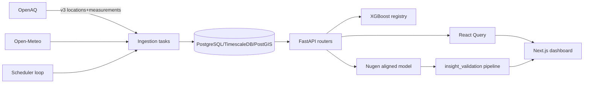

# Complete Project Audit — Features, Accounts, Roles & Architecture

**Date:** 2026-11-10 · **Branch:** `main` @ `fdbc142` · **Method:** evidence-based read-only code audit

---

## 1. Executive Summary

A FastAPI + Next.js smart-city air-quality platform for Indian cities (Pune/PCMC primary, India-wide via OpenAQ). It ingests real OpenAQ measurements, stores them in TimescaleDB/PostGIS, runs XGBoost AQI forecasts and a Nugen-aligned LLM for validated explanations, and exposes role-gated dashboards for administrators, officers, inspectors and citizens.

**Scale:** 36 router modules · 121 HTTP endpoints · 47 frontend routes · 29 DB tables · 4 user roles · 12+ background jobs · 8 external providers.

**Honest headline:** core plumbing is real and verified (OpenAQ ingestion, 775 stations across 33 states, auth, provenance separation), but **most real data is days-thin** — the real-vs-synthetic split is enforced everywhere, so most analytics run in demo mode until OpenAQ history accumulates.

## 2. Technology Stack

| Layer | Technology |
|---|---|
| Frontend | Next.js 15.5.27, React, React Query, Mapbox GL JS 3.8, Recharts, Zustand, Tailwind |
| Backend | FastAPI, SQLAlchemy async, Alembic, Pydantic v2 |
| DB | PostgreSQL + TimescaleDB + PostGIS (Docker `5435:5432`) |
| Cache/queue | Redis (rate limits, locks, cache, local throttler) |
| ML | XGBoost (city-level AQI, registry `xgb-20260910_0348`), statistical fallback |
| LLM | Nugen-aligned Qwen2.5-0.5B (`model_01m6xbrq3n8fa8kk`), Gemini (assistant), Anthropic (key configured) |
| Infra | Docker Compose (backend, frontend, db, redis, migrate), GitHub Actions CI |

## 3. Architecture

Frontend talks to the backend only through the Next.js rewrite `/api/backend/:path* → BACKEND_URL/api/v1/:path*`; secrets never reach the browser.

## 4. User Roles & Accounts

### 4.1 Roles (enum `UserRole`, `backend/app/models/user.py`)

| Role | Purpose |
|---|---|
| `city_administrator` | Full city administration — users, wards, thresholds, all analyst + admin endpoints |
| `pollution_control_officer` | Analyst + enforcement — attribution, sources, analytics, enforcement actions |
| `field_inspector` | Field ops — inspections, evidence submission, assigned-ward scoped |
| `citizen` | Public — live AQI, reports, civic issues (own-city scoped), notifications |

### 4.2 Authorization model (`backend/app/api/deps.py`)

- `get_current_user` → JWT bearer → `CurrentUser` on nearly every endpoint.
- `require_roles(*roles)` → `RequireAdmin` (city_administrator), `RequireStaff` (admin+officer+inspector), `RequireInspectorOnly`, `RequireAnalyst` (admin+officer — analytics/agents/simulator).
- Citizens get row-level scoping: `alerts.py:166` and `civic.py:237,423` restrict citizens to own city/records.
- Frontend mirrors this via `lib/role-policy.ts` (`ANALYST_ROLES`, `ANALYST_ONLY_MODULES`: intelligence→analytics+simulator, ai→agents).

### 4.3 Seeded/demo accounts (`backend/app/core/seeder.py`)

| Email | Role | City | Ward | Type |
|---|---|---|---|---|
| admin@pune.gov.in | CITY_ADMINISTRATOR | Pune | — | Seeded demo |
| officer@mpcb.gov.in | POLLUTION_CONTROL_OFFICER | Pune | — | Seeded demo |
| inspector@pune.gov.in | FIELD_INSPECTOR | Pune | W07 | Seeded demo |
| citizen@pune.in | CITIZEN | Pune | W02 | Seeded demo |

Demo password is configured via `DEMO_USER_PASSWORD` env (documented, value not disclosed). 4 accounts verified present in DB.

### 4.4 Role comparison matrix (verified from deps + endpoint checks)

| Capability | Admin | Officer | Inspector | Citizen |
|---|---|---|---|---|
| Live/India AQI, map, history | ✓ | ✓ | ✓ | ✓ |
| Analytics, attribution, sources | ✓ | ✓ | view | view (own city) |
| AI insights (Nugen) | ✓ | ✓ | ✓ | ✓ |
| Enforcement actions | manage | create/manage | submit evidence | — |
| Civic issues | all | all | assigned | own city, own records |
| Thresholds/alerts config | ✓ | — | — | — |
| Users/wards/stations admin | ✓ | — | — | — |
| Analyst modules (analytics, simulator, agents) | ✓ | ✓ | — | — |
| Reports/transparency | ✓ | ✓ | ✓ | ✓ |

## 5. Frontend — 47 Routes

Modules (all under `/dashboard`, plus `/login`, `/`, `/icon`): about, admin, administration, agents, ai, air-quality (aggregator: live/india/forecast/heatmap/sources/transparency), alert-thresholds, analytics, assistant, citizen, civic, construction-dust, energy, enforcement, environmental, exposure, forecast, green-infrastructure, heat, heatmap, india-aqi, industrial-pollution, intelligence, live-aqi, mobility, officer, operations, recommendations, replay, reports, route-analysis, settings, simulator, smart-mobility, sources, traffic-pollution, transparency, waste-burning, waste-circularity, water.

**Verified working:** india-aqi map (real stations + state filters), heatmap (markers/hotspots/AI-explain), sources (real attribution), air-quality aggregator, login/auth.
**Structurally present, depth unverified:** officer/drone/satellite/civic workflows (exist but field-tested partially).

## 6. Backend — 121 Endpoints / 36 Routers

Key groups (all `/api/v1`, `CurrentUser` required unless noted):

- **auth**: login, refresh, me, logout (JWT access+refresh rotation)
- **aqi**: live, history, stations, india/{heatmap,states,observations}, health-risk
- **gis**: stations/map, pollution-hotspots, hotspot-clusters, ward-boundaries, nearest-stations, buffer-analysis
- **attribution**: live, history (ward source %s)
- **forecast**: XGBoost predictions, model registry, evaluation
- **analytics**: comparison, trends, dispersion, kpi, metrics, model-performance
- **ai**: nugen-status, air-quality-insights (Nugen+validation), assistant/chat (Gemini), agents (LangGraph)
- **enforcement**: actions, evidence, officers
- **civic**: issues, clusters, escalation, evidence, status events (role-scoped)
- **alerts**: thresholds (admin), citizen alerts, mitigation
- **environmental**: heat, energy, water, waste-*, construction-dust, industrial, green-infrastructure
- **ops**: drone, sensors, simulator, replay, notifications, websocket, media-links, reports, dashboard, data-sources, sustainability, traffic, exposure, sensors

## 7. Database — 29 Tables

Core: `users`, `monitoring_stations` (+`openaq_location_id`, PostGIS `geometry`, `state` derived), `aqi_readings` (hypertable-style, `quality_flag` real/synthetic/stale/invalid), `weather_measurements`, `forecast_grids`, `pollution_attributions`, `pollution_hotspots`, `emission_sources`, `heat_readings`, `satellite_observations`, `anomaly_events`.

Civic/ops: `civic_issues` (+`status_events`, `clusters`), `enforcement_actions`, `officer_routes`, `drone_flight_plans`, `intervention_outcomes`, `media/evidence` (files under `backend/media/`).

Admin/ref: `municipalities`, `ward_demographics`, `ward_boundaries`, `ward_offices`, `ward_representatives`, `policy_snapshots`, `alert_thresholds`, `citizen_alerts`, `notifications`, `audit_logs`, `sensor_health_assessments`, `city_water_resources`.

## 8. AI/ML

| Capability | Status | Detail |
|---|---|---|
| XGBoost city AQI | COMPLETE | Registry `xgb-20260910_0348`, chronological split, statistical fallback |
| Station-level forecast | BLOCKED | 1–2 real obs/station — insufficient data (documented) |
| Nugen insights | COMPLETE | Deployed aligned Qwen 0.5B; frozen 10-layer validation (provenance, pollutant identity, units, CPCB band, exercise safety, surgical correction); 8-scenario eval evidence |
| Gemini assistant | COMPLETE | `/assistant/chat`, real inference, graceful 503 on provider DNS fail |
| Anthropic | CONFIGURED-UNVERIFIED | Key set, no code path observed calling it |
| LangGraph agents | PARTIAL | agent framework + tools exist, analyst-gated |

## 9. External Integrations (verified states)

| Provider | Status |
|---|---|
| OpenAQ v3 | WORKING — 775 stations mapped, 33 states, real readings |
| Mapbox | WORKING — token verified; Brave blocks telemetry (harmless) |
| Nugen | WORKING — deployed model + insights |
| Gemini | WORKING — assistant |
| NASA FIRMS | WORKING — CSV verified |
| Open-Meteo | WORKING (keyless) — weather job |
| Twilio | WORKING credentials; `TWILIO_ENABLED` gate |
| Sentinel Hub | INVALID — OAuth 401 |
| Firebase | MISSING — credentials path doesn't exist |
| SMTP | NETWORK_ERROR — host unresolvable |
| Energy provider | UNVERIFIED — CSV-based, no auth endpoint |

## 10. Background Jobs (in-app scheduler)

fetch-live-aqi (10m) · fetch-live-aqi-pune-stations (1m) · discover-india (config) · ingest-india (config) · fetch-weather (15m) · run-attribution (30m) · fetch-satellite-features · dispatch-pending-alerts (1m) · escalate-overdue-civic-issues (15m) · detect-drone-hotspots · anomaly detection · maintenance prediction. Redis-locked, idempotent, rate-limited — verified appending real readings.

## 11. Data Provenance (verified)

- **Real:** 19 OpenAQ readings (13 good, 6 stale), ~90-min window, 775 stations/33 states
- **Synthetic:** 2,028 fixture readings (`quality_flag='synthetic'`, 7-day window) — excluded from real surfaces by default, opt-in `include_synthetic` everywhere, labeled in UI
- **Model-derived:** attributions (receptor model), forecasts, live-fallback attribution labeled `model-derived estimate`
- **Empty-by-design:** exposure (real-only), real hotspots (below spatial/temporal minimum)

## 12. Implementation Status Summary

| Status | Count | Examples |
|---|---|---|
| COMPLETE | ~14 | auth/roles, OpenAQ pipeline, india map, heatmap, sources, Nugen, XGBoost city, attribution, states |
| PARTIAL | ~8 | historical analysis, LangGraph agents, civic workflows, drone/satellite |
| DEMO-ONLY | ~6 | exposure map, most analytics, multi-day history, some intelligence pages |
| BLOCKED | ~4 | station-level forecast, real hotspots, 3B Nugen, live ward exposure |
| BROKEN/CONFIG-BROKEN | ~3 | Sentinel Hub creds, Firebase path, SMTP host |
| NOT IMPLEMENTED | few | some placeholder admin/settings areas |

## 13. Known Issues & Limitations

- Real-data density is the binding constraint for forecasting/hotspots/history.
- `city` filter on attributions is now case-insensitive (fixed); live-fallback multi-station unpack bug fixed.
- Mapbox telemetry blocked by Brave — cosmetic only.
- Background-sync permission denial — browser-level, safely caught.
- `city` field uses OpenAQ locality verbatim (mixed cleanliness).

## 14. Recommendations

1. Let the scheduler accumulate ~1–2 weeks of real data before enabling station forecasts/hotspots.
2. Fix Sentinel/Firebase/SMTP credentials or remove dead config.
3. Promote the attribution live-fallback path to a documented worker output.
4. Add a state-lookup boundary-data refresh path.
